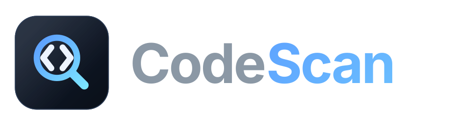
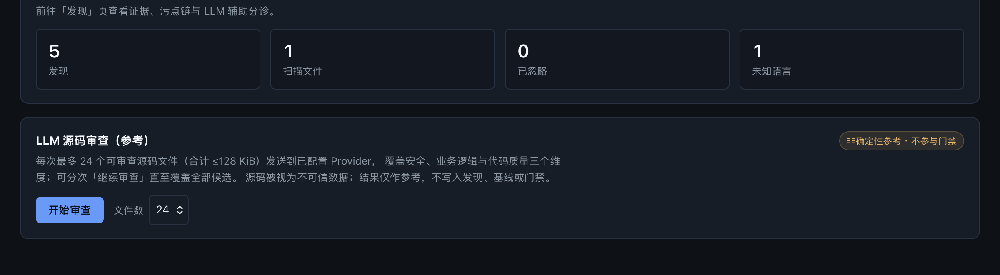
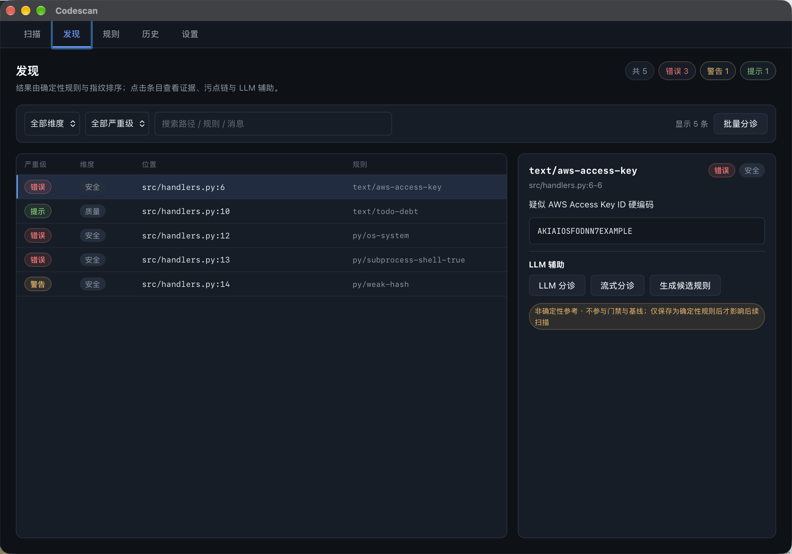

<p align="center"></p>

<p align="center">
  
  
  
</p>

**CodeScan** is a local-first code scanning tool: a self-built deterministic AST rule engine (tree-sitter) plus a Tauri 2 desktop app and a headless CLI. It covers three dimensions — **security vulnerabilities**, **business-logic defects**, and **code quality** — with zero dependency on external scanning engines and no network access during scanning.

> **Platform**: macOS Apple Silicon (arm64) only. Windows / Linux are not supported yet.

中文版：[README.zh-CN.md](README.zh-CN.md)

---

## Screenshots

| Scan | Findings |
|---|---|
|  |  |

The screenshots come from the intentionally vulnerable `examples/demo-workspace/` in this repository. The desktop UI is currently Chinese-only; the CLI, this README, and `docs/en/` are English.

## Why

No open-source tool covers all three dimensions out of the box. Security and quality issues can be expressed as rules, but **business-logic defects are project-specific**: they live in invariants that only the project owner knows (ownership checks, state transitions, amount/quota math, idempotency).

CodeScan takes the deterministic path and makes it explicit:

- a **self-contained rule engine** — rules are declarative, versioned, unit-tested assets; no scanner is orchestrated under the hood;
- **business logic is a first-class dimension** — the engine accepts project invariants as rule files with the same tooling as built-in rules;
- **LLM output never gates anything** — LLM triage / review / candidate rules are advisory, and only rules that pass validation and are explicitly saved affect later scans.

## Features

| Capability | Notes |
|---|---|
| Deterministic AST engine | 73 built-in rules: tree-sitter patterns, text patterns, metric thresholds, taint source→sink rules |
| Three dimensions | Every finding belongs to exactly one of `security`, `business-logic`, `quality` |
| Quality metrics | Cyclomatic complexity, function length, nesting depth, duplicate blocks, unreachable code |
| Taint analysis | Intra-procedural approximation plus cross-file propagation for explicit imports (TS/JS, Python, Go same-package, Java class/static imports, Rust `use` paths), with points-to object sets and field sensitivity |
| Baseline & gate | Freeze a scan as a baseline; gate on *new* findings only, by fingerprint equality |
| SARIF 2.1.0 | One-to-one mapping with internal findings, including the `degraded` marker |
| Desktop app | Scan, findings, rules, history, settings — local SQLite, local data root |
| CLI | `codescan scan` for local checks and CI gating, `codescan github-upload` for SARIF upload |
| LLM assist (BYO key) | Triage, streaming triage, batch triage, workspace source review, candidate rule generation — advisory only |
| Privacy | Scanning is read-only; no telemetry; API keys live in a Rust-owned secrets table |

## Rule coverage

| Language | Rules |
|---|---|
| TypeScript / TSX | 12 |
| JavaScript / JSX | 6 |
| Python | 12 |
| Java | 11 |
| Go | 10 |
| Rust | 11 |
| Language-agnostic (`*`) | 11 (5 metrics + 6 text patterns) |

By dimension: `security` 59 · `business-logic` 3 · `quality` 11.

Rules live in [`crates/engine/rules/`](crates/engine/rules/) as YAML. Adding your own invariants is a first-class workflow — see [docs/rules.md](docs/rules.md).

## Quick start

### Desktop app

1. Download the latest `.dmg` from [Releases](https://github.com/amuluze/codescan/releases) (macOS arm64).
2. Mount and drag **CodeScan** to Applications. Unsigned/ad-hoc builds are quarantined by Gatekeeper — use right-click → *Open* on first launch.
3. In the app: **Scan** → *选择工作区* (pick a workspace) → *开始扫描* → review results under **发现 / Findings**.

### Build from source

Requirements: Node ≥ 22, pnpm ≥ 10, Rust 1.96 (pinned by `rust-toolchain.toml`), and the tree-sitter toolchain used by the engine.

```bash
git clone https://github.com/amuluze/codescan.git
cd codescan
pnpm install          # or: task install
pnpm tauri dev        # or: task dev:app
```

### CLI

```bash
# scan a repository (text output to stdout)
cargo run -p codescan-cli -- scan <repo>

# gate on newly introduced findings only
cargo run -p codescan-cli -- scan <repo> \
  --baseline codescan-baseline.json --fail-on new \
  --format sarif --out codescan.sarif
```

Exit codes: `0` clean · `1` gate hit · `2` usage/runtime error. Full reference: [docs/cli.md](docs/cli.md).

## How a scan works

1. **Walk** — collect files under the workspace honouring the ignore sources below; paths are sorted for determinism.
2. **Classify** — size cap, binary detection, language detection (unknown languages are counted, not silently dropped).
3. **Parse** — tree-sitter with error recovery; files with syntax errors still produce findings, flagged `degraded`.
4. **Match** — AST patterns, text patterns, metric thresholds, and taint source→sink rules run per file.
5. **Correlate** — project-level metrics (duplicate blocks) and cross-file taint analysis.
6. **Finalize** — fingerprint and stable total ordering; findings and events are persisted in the local data root.

Determinism guarantees: identical (file set, enabled rule set, engine version) yields an identical finding set and event set; fingerprints are stable against line drift; nothing machine-specific (timestamps, absolute paths, parallel order) enters a finding.

## Baseline & gating

- A **baseline** is the frozen fingerprint set of a previous scan.
- **Gate diff** = fingerprints of a new scan minus the baseline; only fingerprint equality matters.
- No implicit allow-list exists outside the baseline; removing an entry from the baseline restores its gating effect.
- Non-deterministic sources (LLM, heuristics, unreviewed manual notes) can never enter the gate diff.

## Ignore sources

Scan scope = workspace `.gitignore` + workspace `.codescanignore` + global `~/.codescan/ignore` (all gitignore syntax) + built-in default directories (`node_modules`, `target`, `dist`, `build`, `.venv`, `__pycache__`, `.next`, `coverage`). Ignored and unknown-language files are reported as aggregate scan events, never silently dropped.

## LLM assist (optional, BYO key)

Configure an OpenAI- or Anthropic-compatible provider in **Settings**. The app supports per-finding triage, streaming triage, batch triage, workspace source review (paged, advisory), and candidate rule generation with isolated regression runs.

Boundaries that are enforced in code, not just documented:

- API keys are stored in a Rust-owned SQLite `secrets` table; no command returns key material, and keys never appear in logs, findings, errors, or exports.
- Requests only go to the base URL you configure; there is no built-in telemetry or third-party fallback.
- LLM output is labelled as non-deterministic reference material and never enters findings, baselines, gate diffs, or SARIF.
- A candidate rule affects later scans only after it passes validation and is explicitly saved as a deterministic rule.

Details: [docs/llm.md](docs/llm.md).

## Data & privacy

| Data | Location |
|---|---|
| Scan history, findings, baselines, rule states | `~/.codescan/codescan.db` (SQLite, app-owned) |
| Large tool artifacts | `~/.codescan/artifacts/` |
| Provider API key | `~/.codescan/codescan.db` → `secrets` table (write-only from the UI) |
| Your workspace | **Never modified** — scanning is read-only; exporting is an explicit user action |

The WebView never holds secrets and never touches SQLite directly.

## Repository layout

```text
codescan/
├── crates/engine/        # codescan-engine: rule compilation, matching, metrics, taint, fingerprints, SARIF, baselines
│   ├── rules/            # built-in rules (per language) + fixtures
│   └── tests/            # integration tests (determinism, fail-closed, SARIF, language matrix, performance)
├── crates/cli/           # codescan CLI: scan / SARIF output / GitHub Code Scanning upload
├── apps/desktop/         # Tauri 2 + React 19 desktop app
│   ├── src/              # views: Scan / Findings / Rules / History / Settings
│   └── src-tauri/        # command layer + SQLite (data root ~/.codescan)
├── assets/brand/         # logo + app icon sources
├── docs/                 # CLI, rules, LLM, release documentation
├── .specs/               # domain invariants + task specs (spec-driven development)
├── Taskfile.yml          # task entry points (orchestration only; commands live in package.json scripts)
└── AGENTS.md             # engineering conventions for contributors and agents
```

## Development

```bash
task install        # pnpm install
task dev:app        # Tauri desktop dev mode
task check          # full gate: typecheck + vitest + build + clippy -D warnings + cargo test
```

| Task | Purpose |
|---|---|
| `task check` | Full pre-commit gate |
| `task test` | Frontend unit tests (vitest) |
| `task test:rust` | Rust test suite (engine / rule suites / command layer / CLI) |
| `task test:cli` | CLI black-box tests (exit codes, formats, SARIF upload dry-run) |
| `task typecheck` / `task check:rust` | TS typecheck / clippy `-D warnings` |
| `task build:dmg` | macOS arm64 `.app` + `.dmg` (ad-hoc unsigned) |
| `task scan` / `task scan:sarif` | Scan this repository with the local engine |

`Taskfile.yml` is only an orchestration layer — every command is implemented in `package.json` scripts so the two cannot drift.

## Documentation

| Document | Contents |
|---|---|
| [docs/en/cli.md](docs/en/cli.md) · [中文](docs/cli.md) | CLI reference, exit codes, CI usage, SARIF upload |
| [docs/en/rules.md](docs/en/rules.md) · [中文](docs/rules.md) | Rule format, pattern language, fixtures, taint rules, ignore rules |
| [docs/en/llm.md](docs/en/llm.md) · [中文](docs/llm.md) | LLM provider configuration and boundaries |
| [docs/en/release.md](docs/en/release.md) · [中文](docs/release.md) | Release chain, signing/notarization credentials, updater, troubleshooting |
| [.specs/domain/scan-engine.md](.specs/domain/scan-engine.md) | Domain invariants — the highest-priority constraint for the engine |
| [.specs/tasks/](.specs/tasks/) | Task specs with objectively verifiable acceptance criteria |
| [AGENTS.md](AGENTS.md) | Engineering conventions (spec-driven workflow, determinism rules) |
| [CHANGELOG.md](CHANGELOG.md) | Release notes (Keep a Changelog) |

## Known limitations

- macOS arm64 only; Windows/Linux builds are not wired up yet.
- Release builds are unsigned unless release credentials are configured — first launch needs right-click → *Open*.
- Taint analysis is an approximation: it is not a proof of reachability, and cross-file propagation requires explicit imports.
- The built-in business-logic rules are examples of the mechanism, not a generic business-rule library — project invariants must be written by you.
- LLM workspace review is bounded by per-run file and byte budgets and is advisory; it reviews a subset per run and continues page by page.

## Roadmap

- Windows / Linux packaging parity.
- Larger rule library per language, more project-invariant examples.
- Rule packs shared as versioned YAML bundles.
- Rule authoring UX in the desktop app.

## Contributing

Issues and pull requests are welcome — see [CONTRIBUTING.md](CONTRIBUTING.md) for the workflow, the local gates, and how to contribute rules. Security reports should go through [SECURITY.md](SECURITY.md), not public issues. Everyone participating is expected to follow the [Code of Conduct](CODE_OF_CONDUCT.md).

## License

[MIT](LICENSE) © 2026 amuluze

## Acknowledgements

- [tree-sitter](https://tree-sitter.github.io/tree-sitter/) — incremental parsers and the query language behind the AST rules.
- [Tauri 2](https://tauri.app/) / [React 19](https://react.dev/) — desktop shell and UI.
- [axiom](https://github.com/amuluze/axiom) — the local-first engineering-agent project whose architecture and spec-driven conventions this repository follows.
