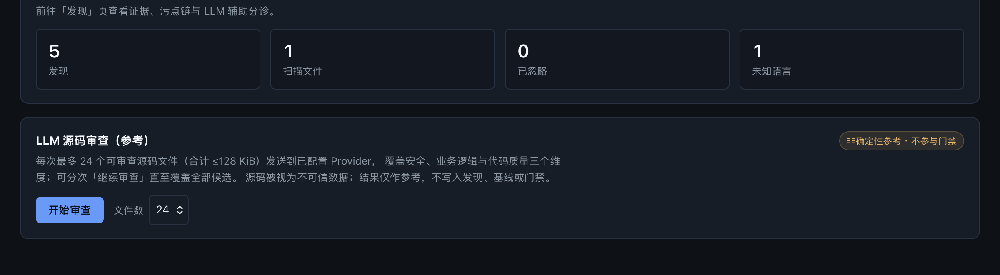
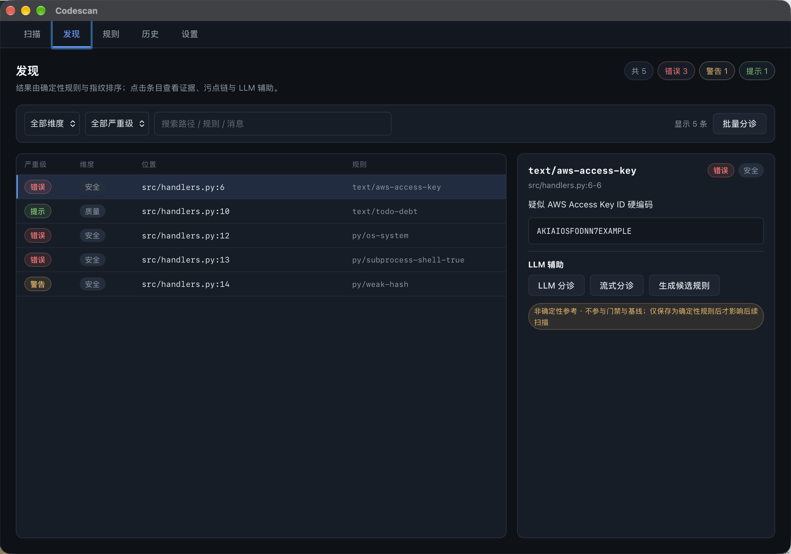

<p align="center"></p>

<p align="center">
  
  
  
</p>

**CodeScan** 是本地优先的代码扫描工具：自研确定性 AST 规则引擎（tree-sitter）+ Tauri 2 桌面应用 + 无头 CLI。三维覆盖 **安全漏洞 / 业务逻辑 / 代码质量**，零外部扫描引擎依赖，扫描过程不联网。

> **平台支持**：仅 macOS Apple Silicon（arm64）。Windows / Linux 暂不支持。

English version: [README.md](README.md)

---

## 界面截图

| 扫描 | 发现 |
|---|---|
|  |  |

截图来自本仓库内故意含缺陷的 `examples/demo-workspace/`。桌面端界面目前仅有中文版本；CLI、本 README 与 `docs/en/` 为英文。

## 为什么做这个

没有一个开源工具能开箱即用地同时覆盖三个维度。安全与质量问题可以表达为规则，但**业务逻辑缺陷是项目特定的**：它存在于只有项目自己知道的不变量里（归属校验、状态跃迁、金额/配额计算、幂等）。

CodeScan 走确定性路线，并把这些边界写进代码：

- **自研规则引擎**：规则是声明式、可版本化、可单测的资产，不编排任何外部扫描器；
- **业务逻辑是一等维度**：项目不变量以规则文件形式固化，与内置规则共用同一套工具链；
- **LLM 输出永不进门禁**：分诊 / 源码审查 / 候选规则仅作参考；只有经校验并显式保存的规则才影响后续扫描。

## 能力

| 能力 | 说明 |
|---|---|
| 确定性 AST 引擎 | 73 条内置规则：tree-sitter 模式、文本模式、度量阈值、污点 source→sink |
| 三维分类 | 每条发现唯一归属 `security` / `business-logic` / `quality` |
| 质量度量 | 圈复杂度、函数长度、嵌套深度、重复块、不可达代码 |
| 污点分析 | 同文件过程间近似 + 显式导入的跨文件传播（TS/JS、Python、Go 同包、Java 类/静态导入、Rust `use` 路径），含 points-to 对象集合与字段敏感 |
| 基线与门禁 | 冻结一次扫描为基线，仅按指纹拦截**新增**发现 |
| SARIF 2.1.0 | 与内部发现一一对应，携带 `degraded` 标记 |
| 桌面应用 | 扫描 / 发现 / 规则 / 历史 / 设置，本地 SQLite 与本地数据根 |
| CLI | `codescan scan` 用于本地检查与 CI 门禁，`codescan github-upload` 上传 SARIF |
| LLM 辅助（自带 Key） | 分诊、流式分诊、批量分诊、工作区源码审查、候选规则生成——仅供参考 |
| 隐私 | 扫描只读、无遥测、密钥存于 Rust 独占的 secrets 表 |

## 规则覆盖

| 语言 | 规则数 |
|---|---|
| TypeScript / TSX | 12 |
| JavaScript / JSX | 6 |
| Python | 12 |
| Java | 11 |
| Go | 10 |
| Rust | 11 |
| 语言无关（`*`） | 11（5 条度量 + 6 条文本规则） |

按维度：`security` 59 · `business-logic` 3 · `quality` 11。

规则位于 [`crates/engine/rules/`](crates/engine/rules/)（YAML）。把项目自己的不变量写成规则是一等公民工作流，见 [docs/rules.md](docs/rules.md)。

## 快速开始

### 桌面应用

1. 从 [Releases](https://github.com/amuluze/codescan/releases) 下载最新 `.dmg`（macOS arm64）。
2. 挂载后把 **CodeScan** 拖入 Applications。未签名/ad-hoc 构建会被 Gatekeeper 隔离，首次启动需右键 → *打开*。
3. 应用内：**扫描** → *选择工作区* → *开始扫描* → 在 **发现** 页查看结果。

### 从源码构建

环境要求：Node ≥ 22、pnpm ≥ 10、Rust 1.96（由 `codescan/rust-toolchain.toml` 锁定），以及引擎所用的 tree-sitter 工具链。

```bash
git clone https://github.com/amuluze/codescan.git
cd codescan
task install
task dev:app
```

### 命令行

```bash
# 扫描仓库（text 输出到 stdout）
cargo run --manifest-path codescan/Cargo.toml -p codescan-cli -- scan <repo>

# 仅按「新增发现」拦截
cargo run --manifest-path codescan/Cargo.toml -p codescan-cli -- scan <repo> \
  --baseline codescan-baseline.json --fail-on new \
  --format sarif --out codescan.sarif
```

退出码：`0` 通过 / `1` 门禁命中 / `2` 用法或运行时错误。完整说明见 [docs/cli.md](docs/cli.md)。

## 扫描流程

1. **收集**：按配置的忽略源遍历工作区，路径排序保证确定性；
2. **分类**：大小上限、二进制检测、语言识别（未知语言计数上报，不静默丢弃）；
3. **解析**：tree-sitter 容错解析，含语法错误的文件仍出发现并标记 `degraded`；
4. **匹配**：AST 模式、文本模式、度量阈值、污点规则逐文件执行；
5. **关联**：项目级度量（重复块）与跨文件污点分析；
6. **定稿**：指纹化与稳定全序排序，发现与事件写入本地数据根。

确定性保证：相同（文件集合、启用规则集、引擎版本）产出完全相同的发现与事件集合；指纹对行号漂移稳定；时间戳、绝对路径、并行顺序等机器差异不进入发现。

## 基线与门禁

- **基线** = 某次扫描的指纹集合快照；
- **门禁差异** = 新扫描指纹集合 \ 基线集合，仅依赖指纹相等性；
- 基线之外没有隐性白名单，移除基线条目即恢复其拦截作用；
- 任何非确定性来源（LLM、启发式、未经冻结的人工标注）都不得进入门禁差异。

## LLM 辅助层（可选，自带 Key）

在**设置**页配置 OpenAI 或 Anthropic 兼容 Provider。支持逐条分诊、流式分诊、批量分诊、工作区源码审查（分页续审，仅供参考）与候选规则生成 + 隔离回归。

以下边界由代码强制，而非仅写在文档里：

- API Key 存于 Rust 独占的 SQLite `secrets` 表；命令面不返回明文，密钥不出现在日志、发现、错误与导出物中；
- 请求只发往你配置的 base_url，无内置遥测与第三方回退；
- LLM 输出显式标注为非确定性参考，永不进入发现、基线、门禁差异与 SARIF；
- 候选规则只有通过校验并显式保存后，才影响后续扫描。

详见 [docs/llm.md](docs/llm.md)。

## 数据与隐私

| 数据 | 位置 |
|---|---|
| 扫描历史、发现、基线、规则状态 | `~/.codescan/codescan.db`（应用自有 SQLite） |
| 大体积工具产物 | `~/.codescan/artifacts/` |
| Provider API Key | `~/.codescan/codescan.db` → `secrets` 表（界面只写不读） |
| 你的工作区 | **绝不修改**——扫描只读；导出需显式操作 |

WebView 不持有密钥明文，也不直接访问 SQLite。

## 目录结构

```text
codescan/                 # CodeScan 工作区
├── crates/engine/        # codescan-engine：规则编译、匹配、度量、污点、指纹、SARIF、基线
│   ├── rules/            # 仅内置规则 YAML（按语言分文件）
│   └── tests/            # 集成测试 + fixtures/rules/ 规则夹具
├── crates/cli/           # codescan CLI：扫描 / SARIF 输出 / GitHub Code Scanning 上传
├── apps/desktop/         # Tauri 2 + React 19 桌面应用
│   ├── src/views/        # 扫描 / 发现 / 规则 / 历史 / 设置页面
│   ├── src/components/   # 跨页面复用组件
│   └── src-tauri/        # 命令层 + SQLite（数据根 ~/.codescan）
├── assets/brand/         # Logo 与应用图标源文件
├── docs/                 # CLI、规则、LLM、发布文档
└── package.json          # 命令实现；../Taskfile.yml 与 ../package.json 仅编排
```

## 开发

```bash
task install        # 从仓库根安装此工作区依赖
task dev:app        # Tauri 桌面开发模式
task check          # 完整门禁：typecheck + vitest + 构建 + clippy -D warnings + cargo test + 第三方声明生成
```

| 任务 | 作用 |
|---|---|
| `task check` | 提交前完整门禁 |
| `task test` | 前端单测（vitest） |
| `task test:rust` | Rust 全量测试（引擎 / 规则套件 / 命令层 / CLI） |
| `task test:cli` | CLI 黑盒测试（退出码、格式、SARIF 上传 dry-run） |
| `task typecheck` / `task check:rust` | TS 类型检查 / clippy `-D warnings` |
| `task build:dmg` | macOS arm64 `.app` + `.dmg`（adhoc 未签名） |
| `task scan` / `task scan:sarif` | 用本地引擎扫描 CodeScan 工作区 |

`../Taskfile.yml` 与仓库根 `package.json` 仅编排，命令实现统一落在本工作区的 `package.json`。

## 文档

| 文档 | 内容 |
|---|---|
| [docs/cli.md](docs/cli.md) · [English](docs/en/cli.md) | CLI 参考、退出码、CI 用法、SARIF 上传 |
| [docs/rules.md](docs/rules.md) · [English](docs/en/rules.md) | 规则格式、模式语言、fixture、污点规则 |
| [docs/llm.md](docs/llm.md) · [English](docs/en/llm.md) | LLM Provider 配置与能力边界 |
| [docs/release.md](docs/release.md) · [English](docs/en/release.md) | 发布链路、签名/公证凭据、updater、故障排查 |
| [.specs/domain/scan-engine.md](../.specs/domain/scan-engine.md) | 领域不变量——引擎的最高优先级约束 |
| [.specs/tasks/](../.specs/tasks/) | 带可客观判定验收标准的任务规格 |
| [AGENTS.md](AGENTS.md) · [仓库约定](../AGENTS.md) | CodeScan 工作区约定与共享流程 |
| [CHANGELOG.md](CHANGELOG.md) | 变更日志（Keep a Changelog 格式） |

## 已知限制

- 污点分析是近似：不是可达性证明，跨文件传播要求显式导入。
- 内置业务逻辑规则是机制示例，不是通用业务规则库——项目不变量需要自己写。
- LLM 工作区审查受单次文件数与体积预算限制，每次只审一部分，需「继续审查」逐页覆盖。

## 路线图

- Windows / Linux 打包对齐。
- 各语言更大的规则库，更多项目不变量示例。
- 以版本化 YAML 包形式分发的规则包。
- 桌面端内的规则编写体验。

## 贡献

欢迎 Issue 与 PR——流程、本地门禁与规则贡献方式见 [CONTRIBUTING.md](../CONTRIBUTING.md)。安全问题请按 [SECURITY.md](../SECURITY.md) 私下报告，不要开公开 Issue。参与者均需遵守 [行为准则](../CODE_OF_CONDUCT.md)。

## 许可证

[MIT](../LICENSE) © 2026 amuluze

## 致谢

- [tree-sitter](https://tree-sitter.github.io/tree-sitter/)——增量解析器与 AST 规则所用的查询语言。
- [Tauri 2](https://tauri.app/) / [React 19](https://react.dev/)——桌面外壳与界面。
- [axiom](https://github.com/amuluze/axiom)——本仓库在架构与 Spec-Driven 约定上参照的本地优先工程 Agent 项目。
