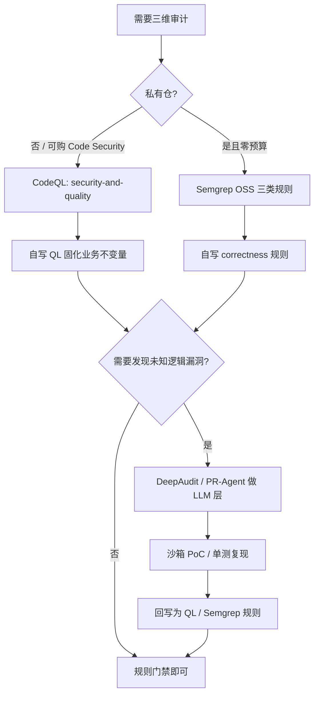

# 开源代码审计工具调研：同时覆盖安全漏洞、业务逻辑、代码质量

- 调研日期：2026-11-06
- 数据快照：GitHub API 元数据 + 各项目官方文档（当日）
- 范围：可自托管、可私有化部署的开源工具；商业 SaaS 仅作为对照

## 1. 摘要

**没有任何免费开源工具能开箱即用地同时覆盖三个维度。**

结构性原因：

1. **安全漏洞**与**代码质量**可以被通用规则表达——污点传播、空指针、复杂度、死代码都有跨语言共性，因此能做成内置规则库。
2. **业务逻辑**没有通用模式。它依赖项目特定的规格（不变量、状态机、权限模型、金额计算规则），静态工具无法从代码本身推导，只能由人把规格写成查询，或由 LLM 结合上下文猜测。

因此实际只有两条路：

- **确定性路径**：用 CodeQL / Semgrep 写自定义查询，把已知业务不变量固化成可回归的规则；
- **启发式路径**：用 LLM/Agent 类工具（DeepAudit、PR-Agent）做语义猜测，再用沙箱 PoC 或测试给出可执行证据。

单工具最接近三维的是 **CodeQL**（内置 `security-and-quality` 覆盖安全+质量，自定义 QL 覆盖业务不变量）。开箱即用三维俱佳的工具不存在。

## 2. 维度定义

| 维度 | 关注内容 | 判定方式 |
|---|---|---|
| 安全漏洞 | 注入、反序列化、SSRF、越权、认证绕过、敏感信息泄露、硬编码凭据 | 数据流可达性 + 污点汇聚点 |
| 业务逻辑 | 权限模型是否被绕过、状态机非法跃迁、金额/库存/配额计算错误、幂等与重复提交 | 项目特定不变量，需显式声明 |
| 代码质量 | 复杂度、重复、死代码、命名冲突、错误处理、并发正确性、可维护性 | 规则库 + 度量 |

注意：**Reliability（可靠性）类规则会与业务逻辑部分重叠但不等于它**。空指针、异常吞掉是通用缺陷；"退款接口没校验订单归属"不是。

## 3. 结论矩阵

图例：✔ 开箱覆盖｜◐ 需自写规则/查询或仅部分覆盖｜✘ 不具备

| 工具 | 安全漏洞 | 业务逻辑 | 代码质量 | 形态 / 许可证 | 关键限制 |
|---|---|---|---|---|---|
| **CodeQL** 10.3k | ✔ `default` / `security-extended` | ◐ 自写 QL（数据流 + CPG，能力最强） | ✔ `security-and-quality` 含 maintainability / reliability | CLI + 查询库，MIT | 私有仓需 GitHub Code Security 许可；QL 学习成本；语言集固定 |
| **Semgrep** 17.5k | ✔ security 规则集 | ◐ 自写 `category: correctness` 规则 | ✔ best-practice / maintainability / performance | 单二进制，LGPL-2.1 | OSS 引擎无跨文件分析（interfile 属 Pro 付费）；纯语法模式，无法证明数据流 |
| **Opengrep** 3.3k | ✔ 复用 Semgrep 规则 | ◐ 同上 | ✔ 同上 | LGPL-2.1 | Semgrep 社区分叉，规则生态与商业插件覆盖弱于上游 |
| **SonarQube Community Build** 11.2k | ◐ 仅规则级 CWE，**无注入/污点引擎** | ✘ Hunter Agent（专打业务逻辑/越权/认证）属 Enterprise 付费 | ✔ 开箱最强：Security / Reliability / Maintainability 三分类 | LGPL-3.0 | 仅主分支分析、无 PR 分析；自定义规则须写 Java 插件 |
| **Qodana** CLI 402★ | ◐ 污点分析需 Ultimate 付费 linter | ✘ | ✔ IntelliJ 检查项，质量维度扎实 | CLI Apache-2.0，Community 免费 / Ultimate 付费 | 深度安全与业务逻辑在付费档 |
| **Joern** 3.6k | ◐ 需自写 CPG 查询 | ◐ 状态机/权限不变量可编码 | ✘ | Apache-2.0 | 无内置规则库，属查询引擎/研究工具 |
| **DeepAudit** 7.3k | ✔ 多 Agent + 沙箱 PoC 验证 | ◐ LLM 语义推断（自述针对"业务逻辑盲点"） | ◐ LLM 评审 | AGPL-3.0，Python/FastAPI | 非确定性；需 LLM/Ollama；AGPL 传染性；结论必须人工复核 |
| **PR-Agent** 15.2k | ◐ LLM 代码评审 | ◐ 结合工单上下文审查意图 | ◐ | MIT | 单次 LLM 调用，无 PoC 验证；社区维护的 legacy 项目 |

> 已排除：Trivy / osv-scanner（仅 SCA）、gitleaks（仅密钥）、Bearer（数据安全/隐私），它们不覆盖三维中的后两维。

## 4. 工具详评

### 4.1 CodeQL —— 唯一能做成"三维确定性"的单工具

- 内置套件三档：`default` → `security-extended` → `security-and-quality`。第三档明确包含"maintainability and reliability issues"，即安全 + 质量一次扫描出结果。
- 业务逻辑靠自定义 QL：CodeQL 的库暴露了控制流、数据流、调用图，可以把"写接口必须调用权限校验""状态字段只能按 A→B→C 迁移"这类不变量编码为查询，并纳入 CI 门禁。这是唯一能对业务逻辑给出**可复现、可回归**结论的开源方案。
- 成本：公有仓免费；私有仓须启用 GitHub Code Security。CLI 可离线跑，但结果上传与 PR 注解依赖 GitHub。
- 语言覆盖：C/C++、C#、Go、Java/Kotlin、JavaScript/TypeScript、Python、Ruby、Swift。

### 4.2 Semgrep / Opengrep —— 规则迭代最快的三层方案

- Registry 的 `metadata.category` 明确定义了 `security`、`correctness`、`maintainability`、`performance`、`portability`、`best-practice` 六类，安全与质量都有现成规则；`correctness` 即业务规则的落点。
- 规则可单测（测试文件用 `ruleid:` / `ok:` 标注），适合把审计结论转成可回归资产。
- 硬限制：OSS 引擎不做跨文件（interfile）分析，跨函数污点属 Pro 付费能力；因此它能表达"出现了什么写法"，不能证明"数据是否真的流到了危险点"。
- Opengrep 为社区分叉，语言支持更宽，但规则生态与商业插件不如上游。

### 4.3 SonarQube Community Build —— 质量维度开箱最好，安全与逻辑被切到付费档

- 官方功能对比表事实：
  - Community Build 的 "Injection vulnerabilities detection" 未勾选，即**没有污点/注入引擎**；
  - "Advanced SAST"、"SCA" 标注为 "From Enterprise"；
  - "Hunter Agent（发现 broken access control、business logic、authentication 缺陷）"为 Enterprise 专属且需单独订阅。
- 因此 CE 能给出的是规则级安全告警 + 完整的质量分类（Security / Reliability / Maintainability），不能当作三维审计。
- 自定义规则只能通过写 Java 插件实现，维护成本高于 QL/YAML。

### 4.4 Qodana —— 质量维度强，安全/逻辑需付费

- CLI 为 Apache-2.0，但 linter 分 Community（免费）与 Ultimate（付费）；污点分析属于 Ultimate 能力。
- 适合已用 JetBrains 技术栈、且只关心质量门禁的团队。

### 4.5 Joern —— CPG 查询引擎，适合专项而非通用

- 提供代码属性图（CPG），可用 CPGQL 表达跨函数的逻辑条件，适合做一次性的深度专项（如"所有支付回调是否校验签名"）。
- 没有规则库、没有质量度量，不适合日常门禁。

### 4.6 DeepAudit —— 目前唯一对"业务逻辑"给出可执行证据的开源方案

- 架构：Orchestrator / Recon / Analysis / Verification 多 Agent 协作，识别技术栈 → 分析风险 → 生成脚本 → **沙箱执行 PoC** → 出报告。
- README 自述解决传统 SAST 三大痛点：误报率高、**业务逻辑盲点**、缺乏验证手段；并声称团队用其发现 49 个 CVE / 6 个 GHSA（自述，未独立复核）。
- 风险：LLM 输出非确定性；AGPL-3.0 对商业集成有传染性；需要模型算力（支持 Ollama 私有部署）；PoC 在沙箱中执行本身带来供应链与逃逸风险，必须隔离网络与凭据。

### 4.7 PR-Agent —— 轻量 LLM 评审，适合 PR 级意图检查

- MIT、15.2k star，支持 GitHub/GitLab/Bitbucket/Azure DevOps/Gitea，单次 LLM 调用完成 `/review`、`/improve`、`/ask`。
- 定位是 PR 评审而非全量审计：没有跨文件数据流，也没有 PoC 验证，结论依赖模型能力与提示词。
- 注意其 README 明确声明为社区维护的 legacy 项目，与 Qodo 商业产品不是同一套。

## 5. 组合方案

### 方案 A：确定性门禁（推荐给有安全专职的团队）

```text
CodeQL (security-and-quality)  →  安全 + 质量 基线
        +
自定义 QL 查询（3~5 条业务不变量）  →  业务逻辑
        ↓
SARIF 汇总 → PR 注解 / 阻断合并
```

优点：结论可复现、可回归、有数据流证据；缺点：私有仓有许可成本，QL 需要专人维护。

### 方案 B：全免费、规则快迭代

```text
Semgrep OSS（security + best-practice + maintainability）
        +
自写 correctness 规则（业务不变量）
        ↓
CI 内 semgrep --config → 退出码门禁
```

优点：零许可成本、规则即代码、可单测；缺点：无跨文件能力，业务规则只能覆盖调用点附近的模式。

### 方案 C：LLM 深挖 + 证据回写

```text
DeepAudit / PR-Agent  →  发现疑似逻辑缺陷
        ↓
沙箱 PoC 或单测复现  →  确认
        ↓
回写成 CodeQL/Semgrep 规则  →  长期回归
```

关键纪律：**LLM 的产出不能直接进门禁**，必须先有可执行证据，再沉淀为确定性规则，否则同一问题下次无法复现，误报会被团队忽略。

## 6. 业务逻辑审计的可行路径

按可靠性排序：

1. **自定义查询（确定性最高）**：把规格写成 QL 或 Semgrep 规则。适用于已知不变量，如"退款必须校验订单归属""状态只能单向流转"。
2. **性质测试 / 模型检验（证据最强）**：用 Hypothesis、fast-check、TLA+ 对状态机与金额计算做性质验证。这类工具不在"代码审计"品类内，但对业务逻辑的证明力高于任何静态扫描。
3. **LLM + 沙箱 PoC（覆盖面最广）**：能发现人没想到的组合，但结果需人工确认，且不可直接作为门禁。

### 6.1 Semgrep 业务规则骨架（可运行）

```yaml
rules:
  - id: refund-endpoint-requires-ownership-check
    languages: [java]
    severity: ERROR
    message: >-
      退款接口未调用归属校验，可能导致越权退款。
      请在方法体内调用 checkOwnership(...) 或等价校验。
    metadata:
      category: correctness
      references:
        - https://owasp.org/www-project-top-ten/
    patterns:
      - pattern: |
          @PostMapping("/refund")
          $RET $M(...) { ... }
      - pattern-not: |
          @PostMapping("/refund")
          $RET $M(...) {
            ...
            checkOwnership(...);
            ...
          }
```

### 6.2 CodeQL 自定义查询骨架（示意，需按所用 CodeQL 库版本校验）

```ql
/**
 * @name 写接口缺少权限校验调用
 * @description 标注为写操作的 Controller 方法未调用任何权限校验方法
 * @kind problem
 * @problem.severity warning
 * @id java/missing-permission-check
 */
import java

from Method m
where
  m.getAnAnnotation().getType().hasQualifiedName("org.springframework.web.bind.annotation", "PostMapping")
  and not exists(MethodAccess ma |
    ma.getEnclosingCallable() = m and
    ma.getMethod().getName().matches("check%")
  )
select m, "写接口未调用权限校验方法"
```

> 说明：上述 QL 为结构示意，`getAnAnnotation()` / 注解限定名等 API 需按实际 CodeQL 版本与目标框架调整；落地时应先在本地 `codeql database analyze` 验证再进门禁。

## 7. 决策树



## 8. 落地清单

- [ ] 确定语言栈与 CI 平台（GitHub Actions / GitLab CI / Jenkins），决定 SARIF 上报路径
- [ ] 选 CodeQL 或 Semgrep 作为基线，先跑 `default` / security 规则集建立存量基线
- [ ] 盘点 3~5 条最关键业务不变量（权限、状态机、金额），写成规则并加单测
- [ ] 规则纳入 PR 门禁：新增问题阻断、存量问题进基线
- [ ] 如需 LLM 层，明确沙箱网络隔离与凭据策略，禁止其输出直接阻断合并
- [ ] 每月复核规则命中率与误报，淘汰长期无人处理的规则

## 9. 风险与未验证项

| 项 | 说明 |
|---|---|
| star 数噪声 | AI 类仓库存在刷榜可能，本报告不以 star 作为质量依据 |
| DeepAudit 战果 | 49 CVE / 6 GHSA 为项目自述，未逐条复核 |
| 许可证 | DeepAudit 为 AGPL-3.0，商业集成前需法务确认；SonarQube 为 LGPL-3.0 |
| CodeQL 私有仓成本 | 需 GitHub Code Security 许可，按活跃贡献者计费 |
| Semgrep 能力边界 | OSS 引擎无跨文件分析，跨函数污点需 Pro |
| 未做实测 | 本报告未对各工具跑真实项目对比误报率/漏报率；QL 与 YAML 骨架未在目标代码库验证 |

## 10. 参考

- CodeQL 查询套件：<https://docs.github.com/en/code-security/concepts/code-scanning/codeql/codeql-query-suites>
- CodeQL 私有仓启用前置条件：<https://docs.github.com/en/code-security/reference/code-scanning/troubleshoot-analysis-errors/private-repository-enablement>
- GitHub Code Quality 指标定义：<https://docs.github.com/en/code-security/reference/code-quality/metrics-and-ratings>
- Semgrep 规则类别：<https://docs.semgrep.dev/contributing/contributing-to-semgrep-rules-repository>
- SonarQube 版本功能对比：<https://docs.sonarsource.com/sonarqube-community-build/feature-comparison-table>
- SonarQube Community Build 添加规则：<https://docs.sonarsource.com/sonarqube-community-build/extension-guide/adding-coding-rules>
- Qodana 版本与定价：<https://www.jetbrains.com/help/qodana/pricing.html>
- Qodana 污点分析：<https://www.jetbrains.com/help/qodana/taint-analysis.html>
- DeepAudit：<https://github.com/lintsinghua/DeepAudit>
- PR-Agent：<https://github.com/qodo-ai/pr-agent>
- Joern：<https://github.com/joernio/joern>
